<div align="center">

<a href="https://art.lameiro0x.com"></a>

# peonza-dots

**Un escritorio Hyprland en cinco acabados, construido alrededor de una peonza.**<br>
<sub>Arch Linux · Hyprland 0.57 en Lua · Quickshell 0.3 · un fichero por tema, y cada programa vestido con él</sub>

<br>

[](https://archlinux.org)
[](https://hyprland.org)
[](https://quickshell.org)
[](LICENSE)

[Despiece](#despiece) · [Cinco acabados](#cinco-acabados) · [En marcha](#en-marcha) · [La peonza](#la-peonza) · [Un acento](#un-acento-un-significado) · [La shell](#la-shell) · [Instalar](#instalar) · [Atajos](#atajos) · [Créditos](#créditos)

<sub><a href="README.md">English</a> · Español</sub>

</div>

<br>

<p align="center">
  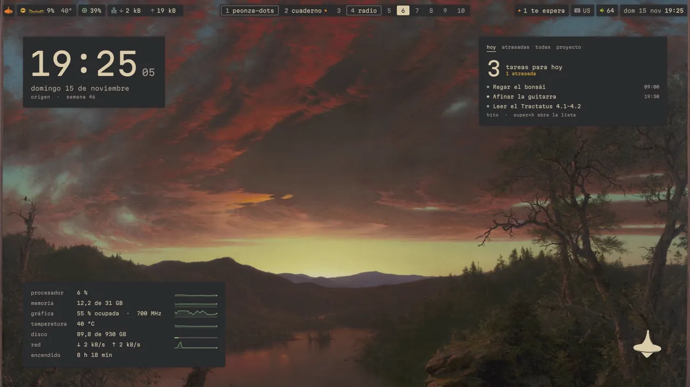
</p>

> La peonza es la marca del autor, y cada superficie del escritorio la dibuja con la misma
> función de pose: el arranque, el acceso, la barra, el prompt, el cursor, un saludo en cada
> terminal, el escritorio y la pestaña nueva del navegador.

## Despiece

<p align="center">
  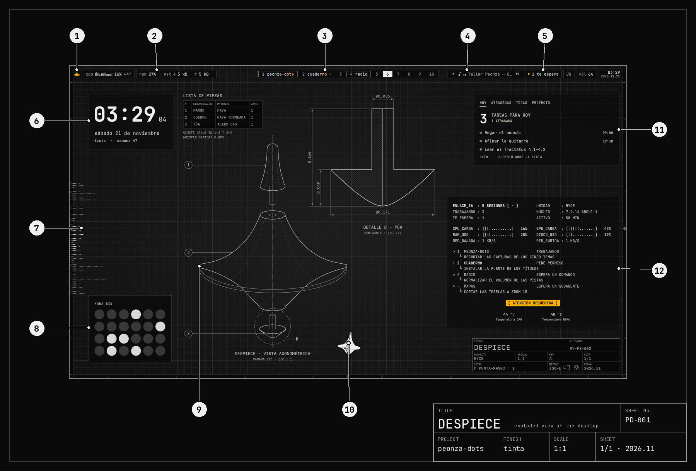
</p>

<p align="center">
  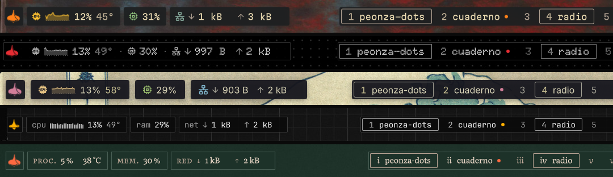
  <br><sub><b>Detalle A.</b> Las piezas 1–3 a tamaño real, en cada acabado.</sub>
</p>

| Nº | Pieza | Qué hace |
|:-:|---|---|
| 1 | **La peonza** | la esquina de la barra: quieta si ninguna sesión trabaja, girando mientras una trabaja, cabeceando en el acento cuando una espera |
| 2 | **Medidores** | carga y temperatura de la CPU, memoria, red |
| 3 | **Escritorios**<br><kbd>Ctrl</kbd>&nbsp;<kbd>1</kbd>…<kbd>0</kbd> | diez huecos, cada uno con el nombre de la sesión de Claude Code que vive en él |
| 4 | **Sonando**<br><kbd>Alt</kbd>&nbsp;<kbd>Super</kbd>&nbsp;<kbd>Espacio</kbd> | cualquier reproductor MPRIS, con sus controles |
| 5 | **Te espera**<br><kbd>Super</kbd>&nbsp;<kbd>A</kbd> | cuántas sesiones te necesitan; un clic abre el panel lateral |
| 6 | **Reloj**<br><kbd>Super</kbd>&nbsp;<kbd>D</kbd> | hora, fecha, tema y semana |
| 7 | **Visualizador de borde** | la música en puntos por el borde de la pantalla, solo mientras suena algo |
| 8 | **Reloj binario** | horas, minutos y segundos en círculos |
| 9 | **La lámina**<br><kbd>Super</kbd>&nbsp;<kbd>Mayús</kbd>&nbsp;<kbd>W</kbd> | el fondo: el plano RY-PZ-002, la peonza despiezada en mango, cuerpo y púa, con su propia lista de piezas |
| 10 | **Peonza del escritorio** | gira a 60 fps mientras el escritorio está despejado |
| 11 | **Hoy**<br><kbd>Super</kbd>&nbsp;<kbd>H</kbd> | las tareas del día en Hito, una app de tareas sobre Supabase; opcional |
| 12 | **HUD** | las sesiones y su paso actual, carga, temperaturas; la que espera, en ámbar |

Mientras trabajas, el escritorio no cuesta nada: si una ventana lo tapa, los widgets se descargan
y queda el fondo estático. Con el escritorio despejado, la peonza gira a 60 fps por un 1–2 % de un
núcleo.

## Cinco acabados

Cada tema es un fichero, [`contracts/themes/<nombre>.json`](contracts/themes), que fija colores,
tipografías, radio de las esquinas, curvas de movimiento, el fondo y su transición, el bloqueo, el
acceso y el arranque. Los generadores lo convierten en la configuración de cada programa del
escritorio, 21 en total, de Hyprland a Plymouth. Cambiar de tema mueve un enlace y avisa a cada
programa: <kbd>Super</kbd>&nbsp;<kbd>T</kbd>, o `ryce-theme set ola`.

<p align="center">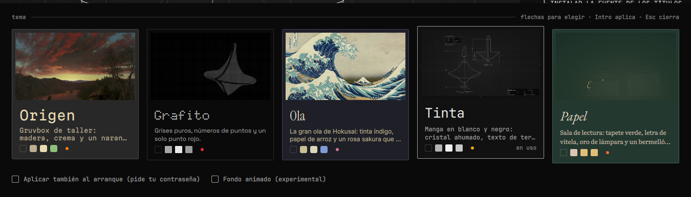</p>

### Origen
Un taller gruvbox: madera, crema y un ocaso pintado. Martian Mono · fichas redondeadas · de cine, con un pequeño rebote · 

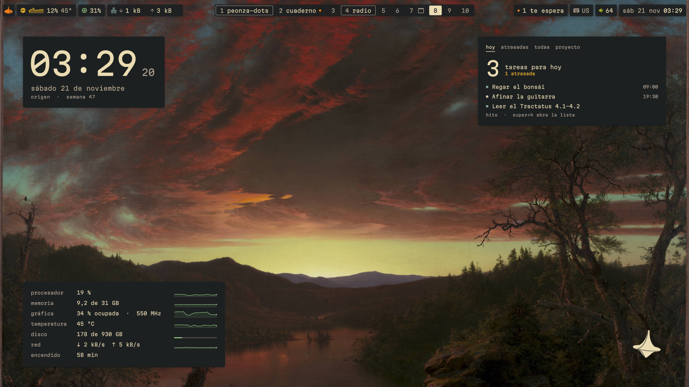

### Grafito
Un instrumento: grises puros y números de puntos. Space Grotesk y Doto · esquinas casi vivas · corto y seco · 

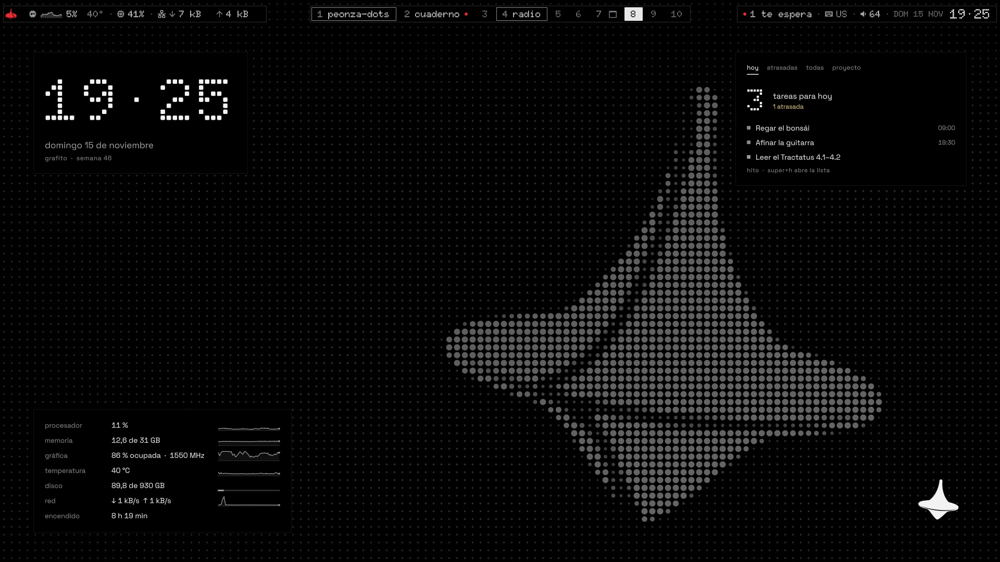

### Ola
La ola de Hokusai: tinta índigo y papel de arroz. Inter e Instrument Serif · cápsulas y squircles · muelles · 

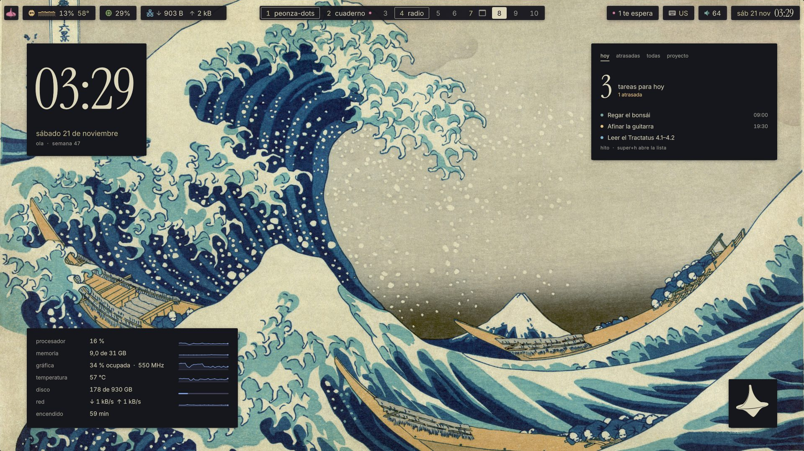

### Tinta
Tinta en blanco y negro, cristal ahumado y láminas técnicas. JetBrains Mono · filos de 1 px · fundidos de terminal · 

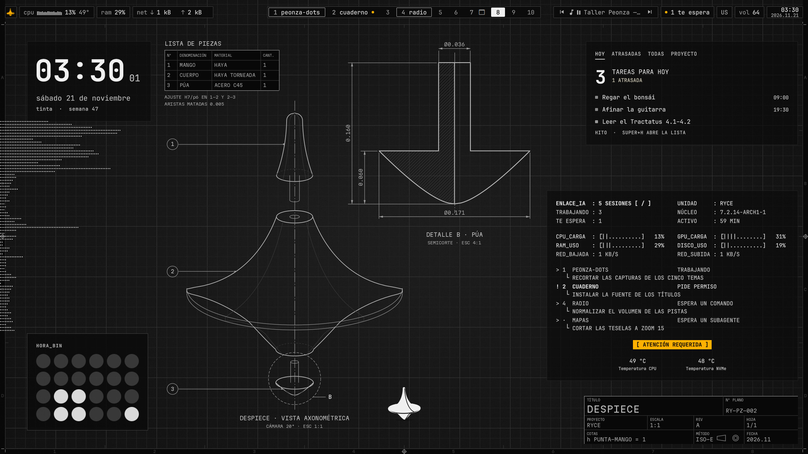

### Papel
Una sala de lectura de noche: tapete verde, letra de vitela, oro para los adornos y la hora escrita en palabras. Literata y EB Garamond en cursiva · números romanos y versalitas · una página que se asienta · Obsidian vestido de libro · 

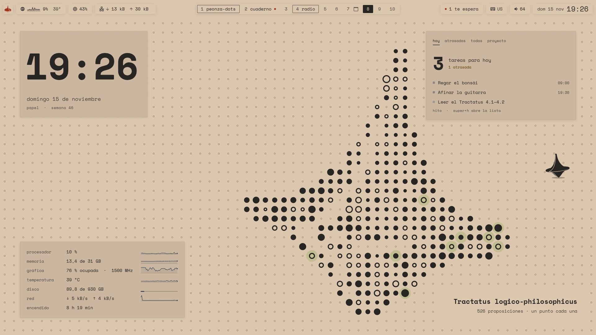

<details>
<summary><b>Los mismos cinco, trabajando</b></summary>
<br>
<table>
<tr><td width="50%">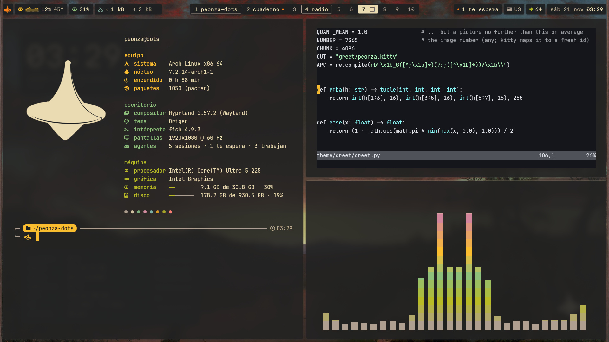</td><td width="50%">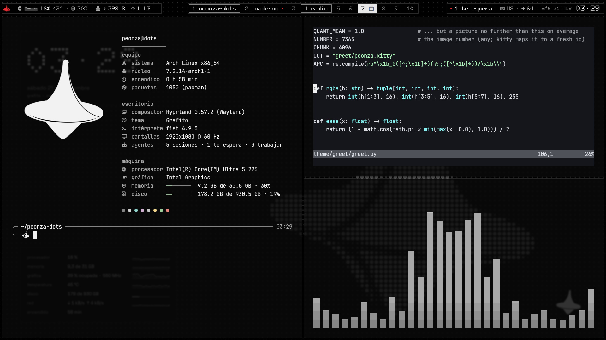</td></tr>
<tr><td>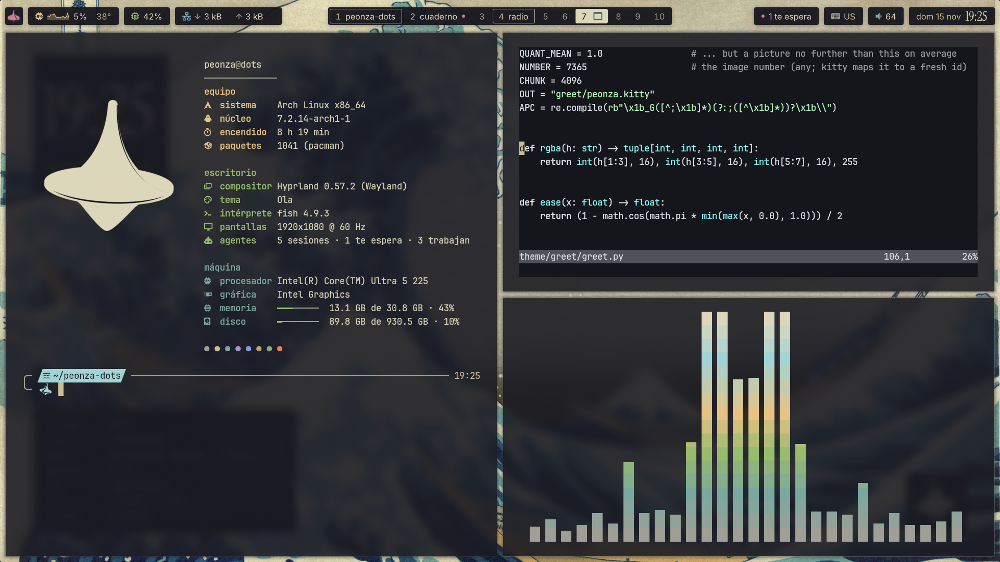</td><td>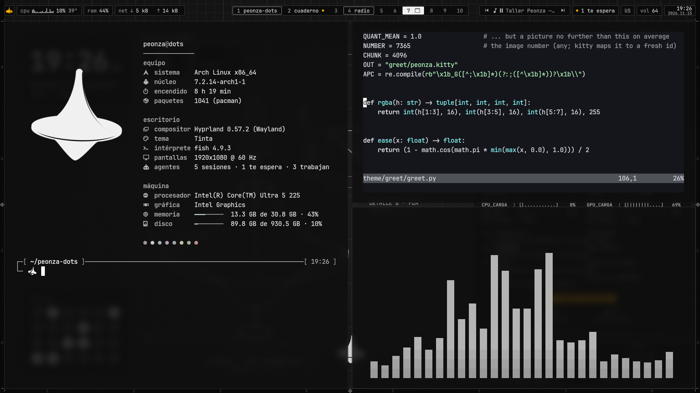</td></tr>
<tr><td>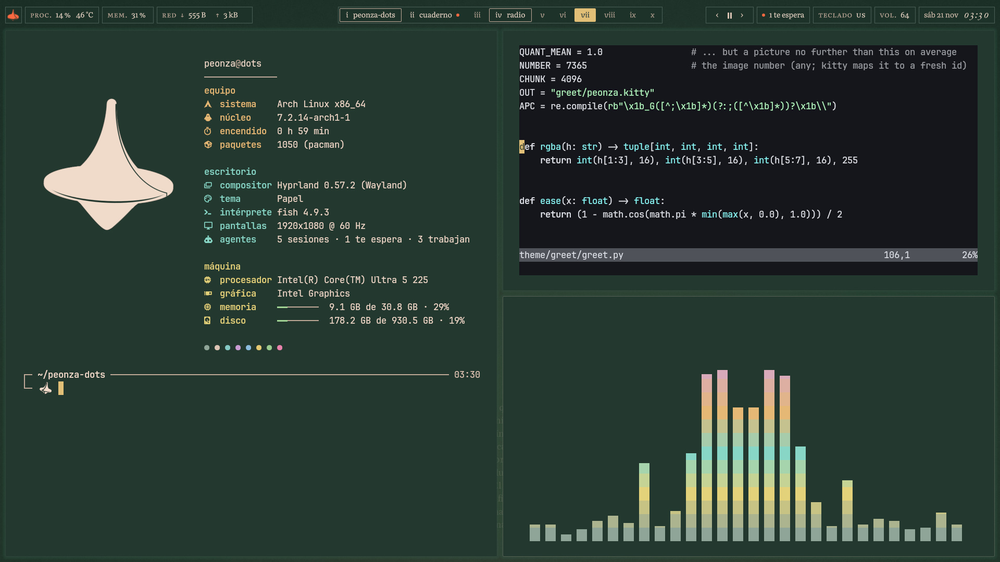</td><td></td></tr>
</table>
</details>

## En marcha

https://github.com/user-attachments/assets/42c5e769-f902-4be1-b90a-a8c7440fbc11

<sub>Grabado dentro de un Hyprland anidado con tareas, sesiones y una pista de música inventadas;
`tools/showcase/` lo vuelve a hacer desde cero.</sub>

## La peonza

<table>
<tr>
<td width="50%">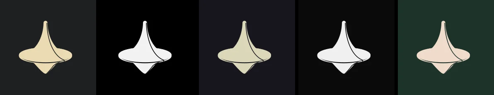</td>
<td width="50%">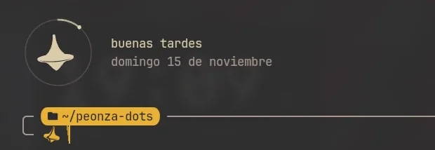</td>
</tr>
<tr>
<td><sub><b>Arranque.</b> Plymouth, un fotograma por refresco a 60 Hz, 72 fotogramas por vuelta.</sub></td>
<td><sub><b>Cada terminal.</b> Un saludo de cuatro líneas con el protocolo gráfico de kitty, precalculado por tema y servido con <code>cat</code>: nada de Python al abrir la shell. <code>set -U ryce_greet off</code> lo apaga.</sub></td>
</tr>
</table>

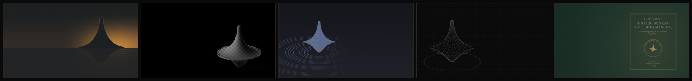

<sub><b>La pestaña nueva.</b> Cada tema dibuja la suya, nacida del perfil medido de la peonza. El
prompt también termina con ella, un carácter de la fuente <i>Ryce Peonza</i> que se pone rojo si el
último comando falló, y el cursor es otra peonza.</sub>

## Un acento, un significado

Cada tema tiene un color de acento, y dice una sola cosa: **una sesión te espera.** Enciende el
borde de su ventana, su hueco en la barra y la peonza de la esquina. Si no ves el acento, nadie te
necesita. Un linter hace fallar la compilación si el acento aparece en cualquier otro sitio.

Las sesiones las cuenta `agentd`, un servicio pequeño en Python (solo librería estándar, menos de
40 MB). Cruza el socket de eventos de Hyprland, `/proc` y los ficheros de sesión de Claude Code
para saber qué terminal lleva qué sesión, si trabaja, espera o descansa, y su paso actual. Nunca
lee tus prompts. Si se para, la barra vuelve a los números; si Quickshell se cae tres veces
seguidas, Waybar toma el relevo con la misma paleta.

Mientras una sesión trabaja, `agentd` también impide que la pantalla se bloquee o se apague,
para que la sigas desde el otro lado de la habitación. Mantiene un único candado de inactividad
de logind, solo mientras los ficheros de la sesión siguen cambiando. Esperar tu respuesta no
cuenta. El candado se suelta un minuto después de que el trabajo pare, y vuelven los tiempos de
siempre.

## La shell

| Nº | Pieza | Qué hace |
|:-:|---|---|
| 13 | **Panel lateral**<br><kbd>Super</kbd>&nbsp;<kbd>A</kbd> | las sesiones y su paso actual, la música con un visualizador, no molestar, luz nocturna, tus cascos Bluetooth con su batería, volumen |
| 14 | **Música**<br><kbd>Super</kbd>&nbsp;<kbd>M</kbd> | un reproductor para Navidrome y otros servidores Subsonic, con portadas y cola; suena por mpv, así que las teclas multimedia y la barra lo ven |
| 15 | **Tareas**<br><kbd>Super</kbd>&nbsp;<kbd>H</kbd> | las listas de Hito: hoy, atrasadas, próximas |
| 16 | **Chuleta**<br><kbd>Super</kbd>&nbsp;<kbd>F1</kbd> | todos los atajos, generados de la misma tabla que los define |
| 17 | **Volumen** | un aviso con la peonza y un nivel |

<table>
<tr>
<td width="50%" valign="top">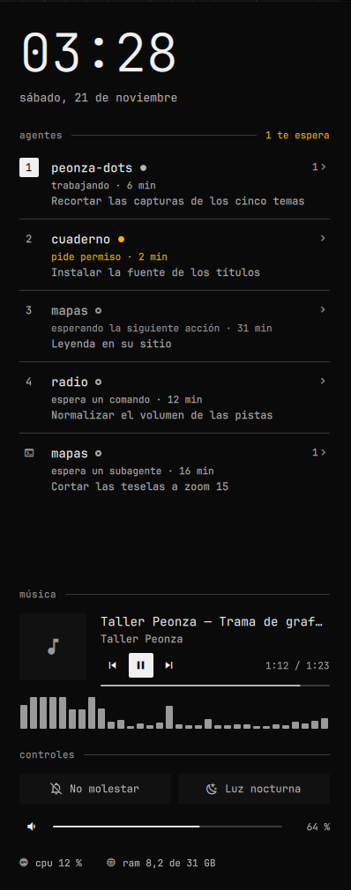</td>
<td width="50%" valign="top">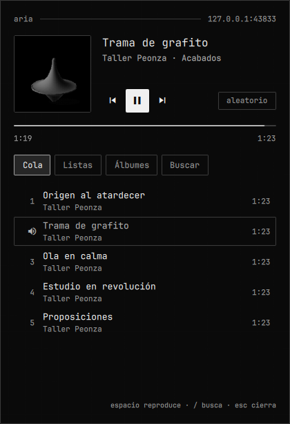<br><br>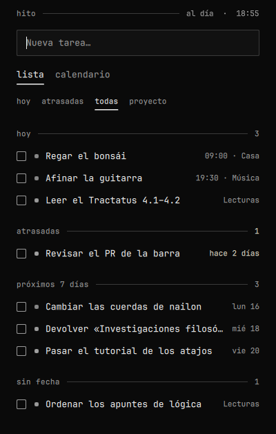</td>
</tr>
<tr>
<td colspan="2">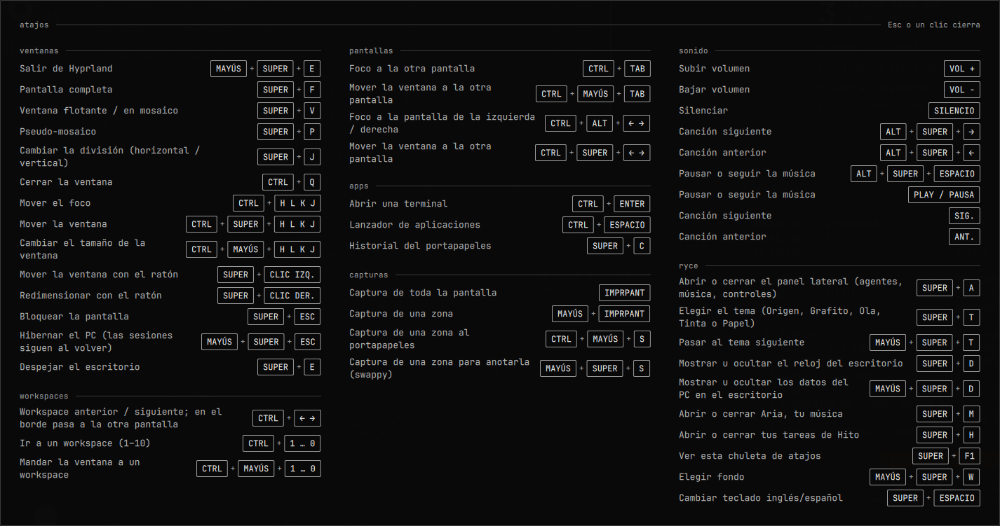</td>
</tr>
</table>

<details>
<summary><b>Cómo está hecho</b></summary>
<br>

- **Una fuente por tema.** `contracts/themes/<tema>.json` → `theme/render.py` y los generadores →
  `themes/<tema>/`, guardado en el repo. Los programas: Hyprland, la barra y los paneles de
  Quickshell, Waybar, kitty, fish y starship, rofi, mako, btop, cava, Neovim, VS Code, GTK, Qt,
  Feishin, Zotero, Chromium, hyprlock, la pantalla de acceso, GRUB, Plymouth y Claude Code. Un
  tema puede sustituir una plantilla (`theme/templates/@<tema>/`) para cambiar la forma y no solo
  el color. El generador rechaza un tema con texto por debajo de 4,5:1 de contraste o con el
  acento a menos de ΔE2000 20 de un gris.
- **Atajos de una tabla.** `keys/keymap.tsv` genera `hypr/binds.lua`, la chuleta y
  [`docs/atajos.md`](docs/atajos.md).
- **Hyprland 0.57 habla Lua.** La configuración es `hypr/*.lua`, validada con `--verify-config`.
- **Un escenario en vez de una VM.** `tools/stage/nested.sh` lanza un Hyprland anidado, escondido
  en un escritorio especial de tu propia sesión, con su propio D-Bus, estado y tema. De ahí salen
  las pruebas, las capturas y el vídeo.
- **Comprobaciones.** `bash check.sh` pasa los tests, las comprobaciones de paleta y contraste,
  el linter, shellcheck y la verificación de la configuración.
- **Las fuentes de la marca son privadas.** Todo lo dibujado con la peonza viene ya hecho; las
  comprobaciones que lo redibujan se saltan solas si faltan las fuentes.

</details>

## Instalar

> [!IMPORTANT]
> Solo Arch Linux, probado con Hyprland 0.57.x y Quickshell 0.3.2. Las versiones menores de
> Hyprland rompen configuraciones: mira antes `hyprctl version`. Con NVIDIA, los drivers son cosa tuya.

```sh
git clone --depth 1 https://github.com/lameiro0x/peonza-dots ~/peonza-dots
cd ~/peonza-dots
./install.sh            # enseña el plan y pregunta una vez
```

El instalador solo usa paquetes oficiales de Arch: sin helper de AUR (yay, paru) y nunca un
`-Syu` a tus espaldas. Enlaza cada fichero de configuración uno a uno, así que deja la carpeta
donde la clonaste, y mueve lo que sustituye a `~/.local/state/ryce/backup/`, apuntando cada
movimiento en un manifiesto. No toca nada de `/etc` salvo que lo pidas.

| Opción | Efecto |
|---|---|
| `--dry-run` | enseña el plan sin cambiar nada |
| `--theme NOMBRE` | empezar en `origen`, `grafito`, `ola`, `tinta` o `papel` |
| `--configs-only` | solo enlaces: sin paquetes y sin sudo |
| `--packages core\|apps\|dev` | cuánto instalar (`core` por defecto) |
| `--system` | carpetas XDG y la pantalla de acceso con el tema (greetd), solo si no hay otro gestor de sesión |
| `--boot` | GRUB y Plymouth con el tema: primero un simulacro, luego de verdad, con vuelta atrás |
| `--uninstall` | quita los enlaces y devuelve tus ficheros, según el manifiesto |
| `--restore [MARCA]` | devuelve un juego de copias |

Los textos del propio escritorio están en español. Las piezas opcionales no estorban si les falta
con quién hablar: la tarjeta de tareas necesita un backend de Hito, el panel de música pide un
servidor Navidrome la primera vez que lo abres, y la barra de agentes solo se enciende si usas
Claude Code. Lo propio de cada máquina, como los monitores y la distribución de teclado, va en
`hypr/local.lua`, que nunca se sube.

## Atajos

<kbd>Ctrl</kbd> es la tecla principal, y Bloq Mayús es otro <kbd>Ctrl</kbd>.

| Teclas | Hacen |
|---|---|
| <kbd>Ctrl</kbd>&nbsp;<kbd>Enter</kbd> · <kbd>Ctrl</kbd>&nbsp;<kbd>Espacio</kbd> · <kbd>Ctrl</kbd>&nbsp;<kbd>Q</kbd> | terminal · lanzador · cerrar |
| <kbd>Ctrl</kbd>&nbsp;<kbd>1</kbd>…<kbd>0</kbd> · <kbd>Ctrl</kbd>&nbsp;<kbd>←</kbd>&nbsp;<kbd>→</kbd> | escritorio · anterior, siguiente (1–5 en la primera pantalla, 6–10 en la segunda) |
| <kbd>Ctrl</kbd>&nbsp;<kbd>H</kbd>&nbsp;<kbd>J</kbd>&nbsp;<kbd>K</kbd>&nbsp;<kbd>L</kbd> | mover el foco |
| <kbd>Super</kbd>&nbsp;<kbd>T</kbd> · <kbd>Super</kbd>&nbsp;<kbd>Mayús</kbd>&nbsp;<kbd>T</kbd> | selector de temas · tema siguiente |
| <kbd>Super</kbd>&nbsp;<kbd>A</kbd> | panel lateral |
| <kbd>Super</kbd>&nbsp;<kbd>B</kbd> | conectar los cascos Bluetooth, o reconectarlos si están conectados pero no suenan |
| <kbd>Super</kbd>&nbsp;<kbd>M</kbd> · <kbd>Super</kbd>&nbsp;<kbd>H</kbd> | música · tareas |
| <kbd>Super</kbd>&nbsp;<kbd>D</kbd> · <kbd>Super</kbd>&nbsp;<kbd>Mayús</kbd>&nbsp;<kbd>D</kbd> | reloj del escritorio · datos del PC |
| <kbd>Super</kbd>&nbsp;<kbd>Mayús</kbd>&nbsp;<kbd>W</kbd> | selector de fondos |
| <kbd>Super</kbd>&nbsp;<kbd>Esc</kbd> | bloquear |
| <kbd>Super</kbd>&nbsp;<kbd>F1</kbd> | todos los demás |

## Créditos

Hecho sobre [Hyprland](https://hyprland.org), [Quickshell](https://quickshell.org),
[awww](https://github.com/LGFae/awww), [kitty](https://sw.kovidgoyal.net/kitty/),
[cava](https://github.com/karlstav/cava), [btop](https://github.com/aristocratos/btop),
[fish](https://fishshell.com), [starship](https://starship.rs) y
[Waybar](https://github.com/Alexays/Waybar). Inspirado por el método, no por las configuraciones,
de muchos posts de r/unixporn; el bloqueo de Tinta sigue la composición del de
[1tg82cr](https://www.reddit.com/r/unixporn/comments/1tg82cr/).

Los fondos que no se dibujan aquí son escaneos de dominio público: Katsushika Hokusai, *La gran
ola de Kanagawa*, *Viento del sur, cielo despejado* y *Kajikazawa en la provincia de Kai*; Utagawa
Hiroshige, *Los remolinos de Awa*; Frederic Edwin Church, *Twilight in the Wilderness*; Jasper
Francis Cropsey, *Autumn – On the Hudson River*. Las fuentes están en
[`assets/wallpapers/README.md`](assets/wallpapers/README.md). Tipografías: Martian Mono, Space
Grotesk, Doto, Instrument Serif, Literata y EB Garamond, con licencia SIL OFL.

## Licencia

El código es [MIT](LICENSE). La marca peonza y todo lo que se dibuja con ella (los fondos
generados, el arte del arranque, el acceso y la pestaña nueva, el cursor, los caracteres de
*Ryce Peonza* y las imágenes de este README) son © lameiro0x, con todos los derechos reservados, y
vienen para que el escritorio funcione; ver [NOTICE](NOTICE). Más peonza en
**[art.lameiro0x.com](https://art.lameiro0x.com)**.

```text
┌───────────────────────────────┬───────────────┐
│ TÍTULO  peonza-dots           │ HOJA   PD-001 │
├───────────────┬───────────────┼───────────────┤
│ PROYECTO ryce │ ESCALA 1:1    │ FECHA 2026.11 │
├───────────────┴───────────────┴───────────────┤
│ DIBUJO lameiro0x · art.lameiro0x.com          │
└───────────────────────────────────────────────┘
```
