<div align="center">

<a href="https://art.lameiro0x.com"></a>

# peonza-dots

**A Hyprland desktop in five finishes, built around a spinning top.**<br>
<sub>Arch Linux · Hyprland 0.57 in Lua · Quickshell 0.3 · one file per theme, every program themed from it</sub>

<br>

[](https://archlinux.org)
[](https://hyprland.org)
[](https://quickshell.org)
[](LICENSE)

[Exploded view](#exploded-view) · [Five finishes](#five-finishes) · [In motion](#in-motion) · [The top](#the-top) · [One accent](#one-accent-one-meaning) · [The shell](#the-shell) · [Install](#install) · [Keys](#keys) · [Credits](#credits)

<sub>English · <a href="README.es.md">Español</a></sub>

</div>

<br>

<p align="center">
  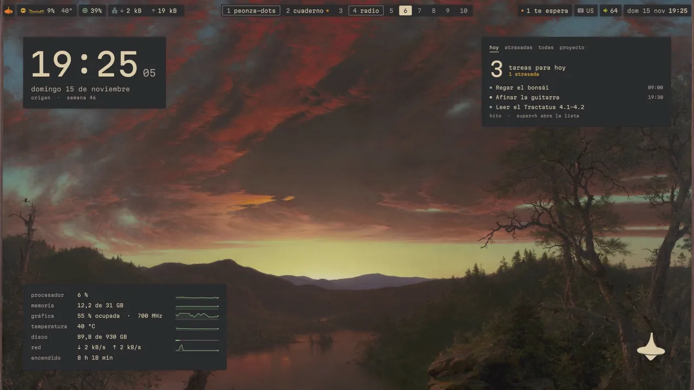
</p>

> *Peonza* is Spanish for spinning top. This one is the author's mark, and every surface of
> the desktop draws it from the same pose function: the boot screen, the login, the bar, the
> prompt, the cursor, a greeter in every terminal, the desk and the browser's new tab.

## Exploded view

<p align="center">
  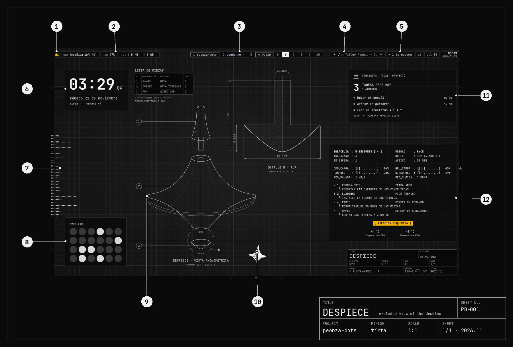
</p>

<p align="center">
  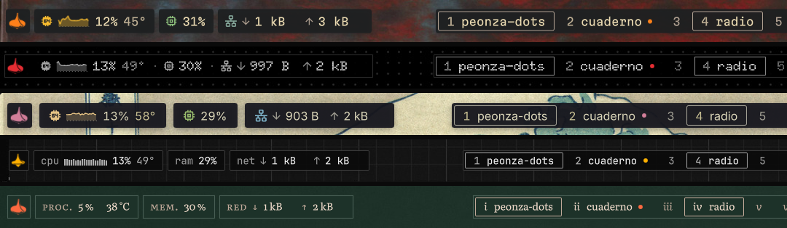
  <br><sub><b>Detail A.</b> Parts 1–3 at full size, in each finish.</sub>
</p>

| № | Part | What it does |
|:-:|---|---|
| 1 | **The top** | the bar's corner: still while no session works, spinning while one does, nodding in the accent when one waits |
| 2 | **Gauges** | CPU load and temperature, memory, network |
| 3 | **Workspaces**<br><kbd>Ctrl</kbd>&nbsp;<kbd>1</kbd>…<kbd>0</kbd> | ten slots, each named after the Claude Code session living in it |
| 4 | **Now playing**<br><kbd>Alt</kbd>&nbsp;<kbd>Super</kbd>&nbsp;<kbd>Space</kbd> | any MPRIS player, with its controls |
| 5 | **Waiting**<br><kbd>Super</kbd>&nbsp;<kbd>A</kbd> | how many sessions need you; a click opens the side panel |
| 6 | **Desk clock**<br><kbd>Super</kbd>&nbsp;<kbd>D</kbd> | time, date, theme and week |
| 7 | **Edge visualiser** | the music as dots along the screen's edge, only while something plays |
| 8 | **Binary clock** | hours, minutes and seconds in circles |
| 9 | **The sheet**<br><kbd>Super</kbd>&nbsp;<kbd>Shift</kbd>&nbsp;<kbd>W</kbd> | the wallpaper: drawing RY-PZ-002, the top exploded into grip, body and tip, with its own parts list |
| 10 | **Desk top** | spins at 60 fps while the desk is bare |
| 11 | **Today**<br><kbd>Super</kbd>&nbsp;<kbd>H</kbd> | the day's tasks from Hito, a task app on Supabase; optional |
| 12 | **HUD** | sessions and their current step, load, temperatures; the one waiting in amber |

Nothing on the desk costs anything while you work: when a window covers it, the widgets unload
and the static wallpaper stays. When the desk is bare, the top spins at 60 fps for about 1–2%
of one core.

## Five finishes

Each theme is one file, [`contracts/themes/<name>.json`](contracts/themes), that sets colours,
fonts, corner radius, motion curves, the wallpaper and its transition, the lock screen, the
login and the boot. The generators turn it into the config of every program on the desk, 21 of
them, from Hyprland to Plymouth. Switching moves one symlink and signals each program:
<kbd>Super</kbd>&nbsp;<kbd>T</kbd>, or `ryce-theme set ola`.

<p align="center">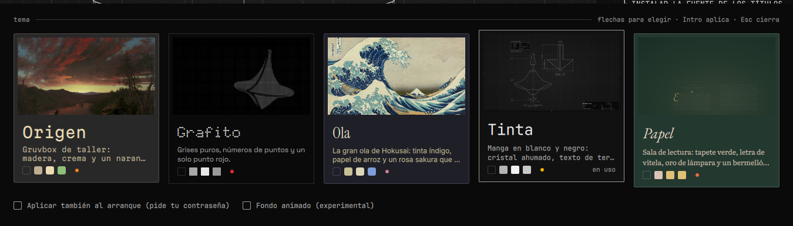</p>

### Origen
A gruvbox workshop: wood, cream and a painted dusk. Martian Mono · rounded chips · cinematic, with a small bounce · 

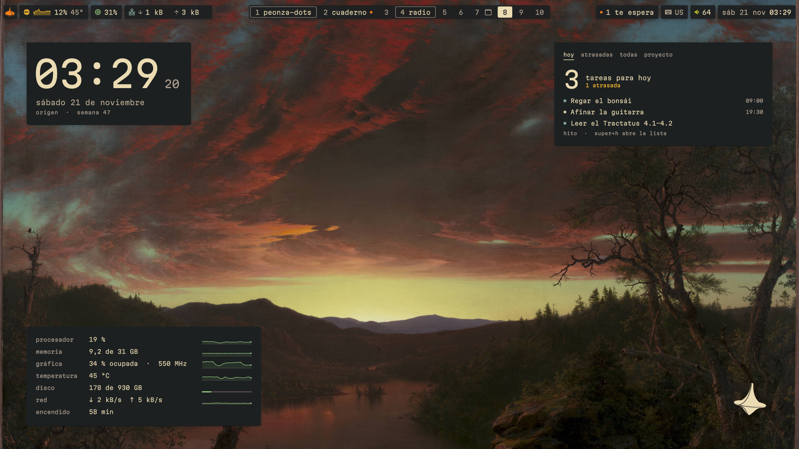

### Grafito
An instrument: pure greys and dot-matrix numerals. Space Grotesk and Doto · almost square · short and dry · 

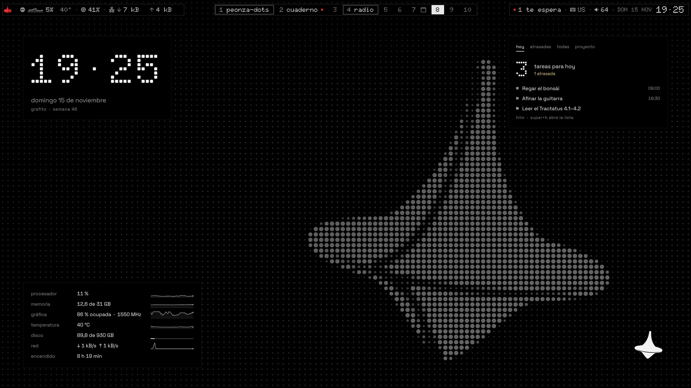

### Ola
Hokusai's wave: indigo ink and rice paper. Inter and Instrument Serif · capsules and squircles · springs · 

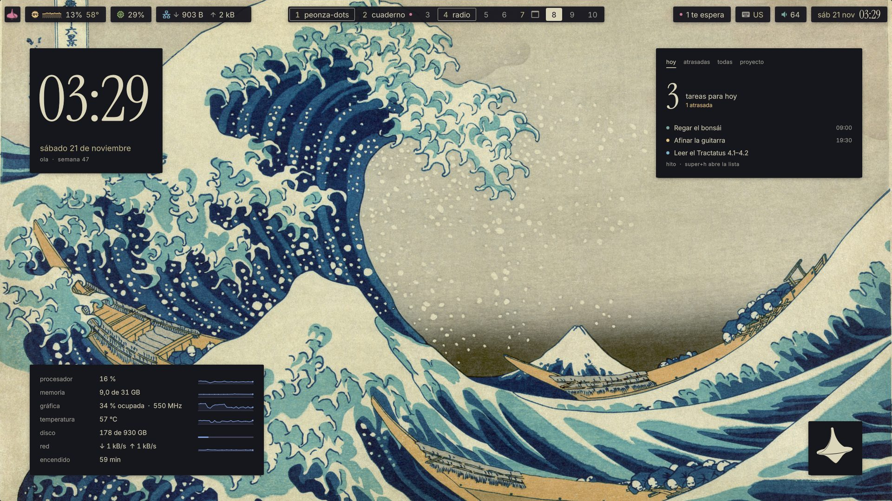

### Tinta
Black-and-white ink, smoked glass and drawing sheets. JetBrains Mono · 1 px edges · terminal-fast fades · 

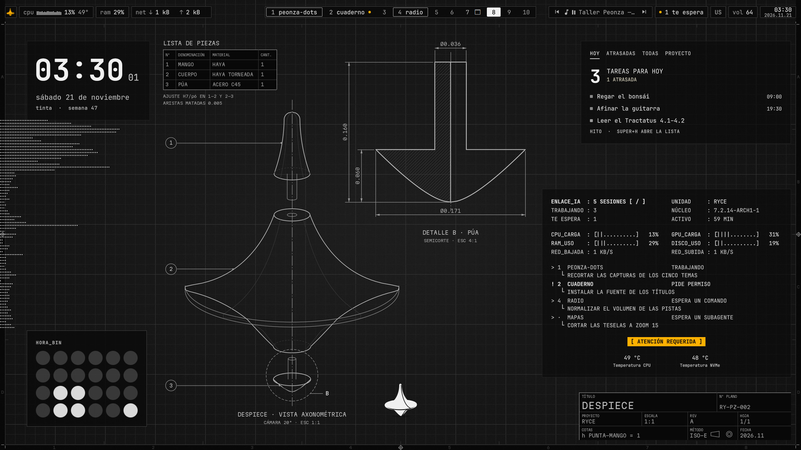

### Papel
The only light one, for reading: warm ink on cream. Space Mono · a sheet, nearly square · a page settling · 

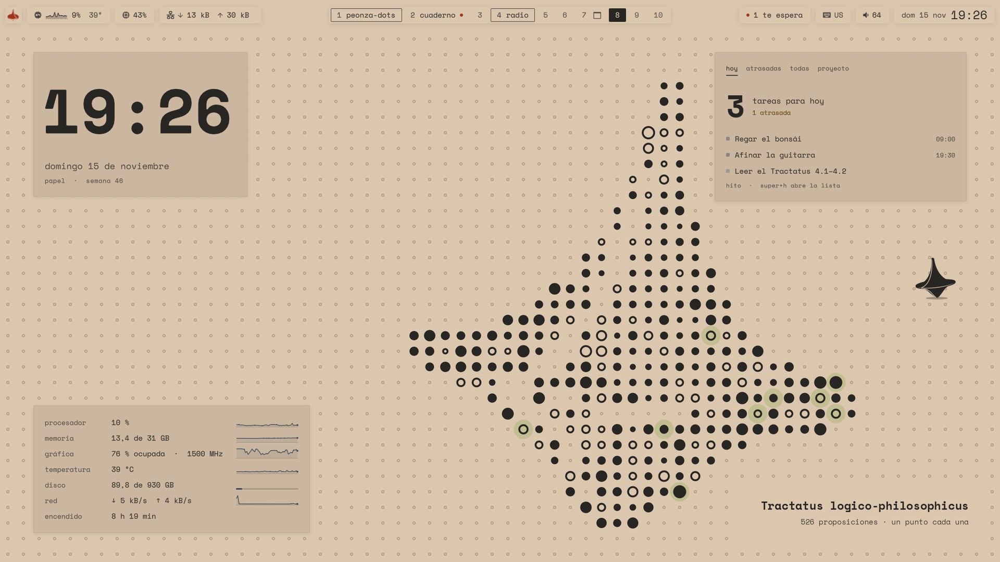

<details>
<summary><b>The same five at work</b></summary>
<br>
<table>
<tr><td width="50%">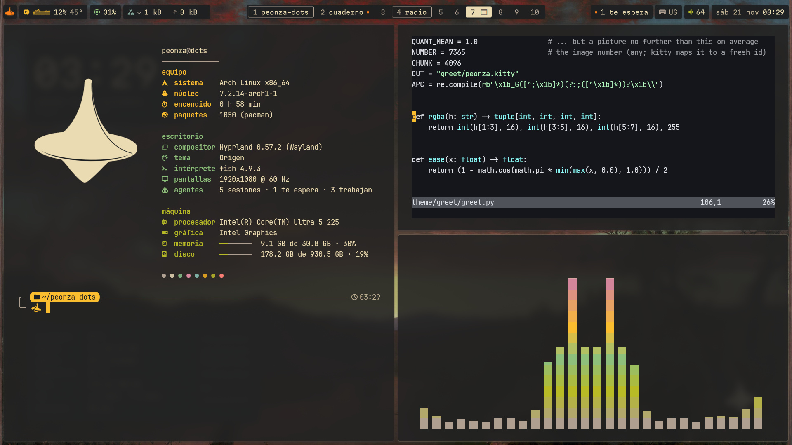</td><td width="50%">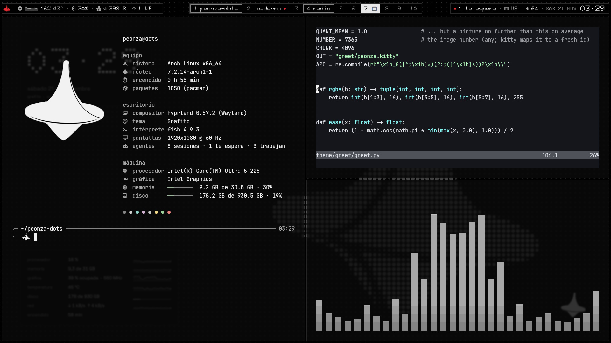</td></tr>
<tr><td>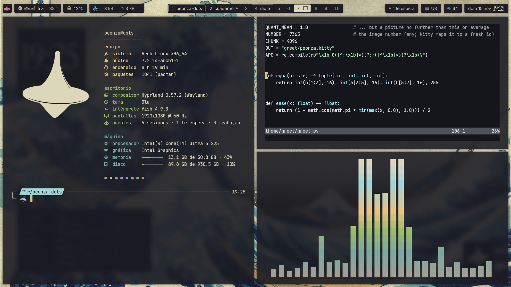</td><td>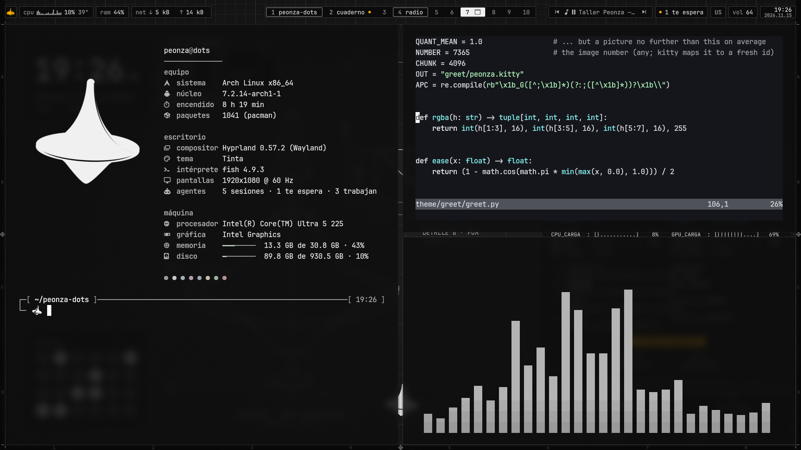</td></tr>
<tr><td>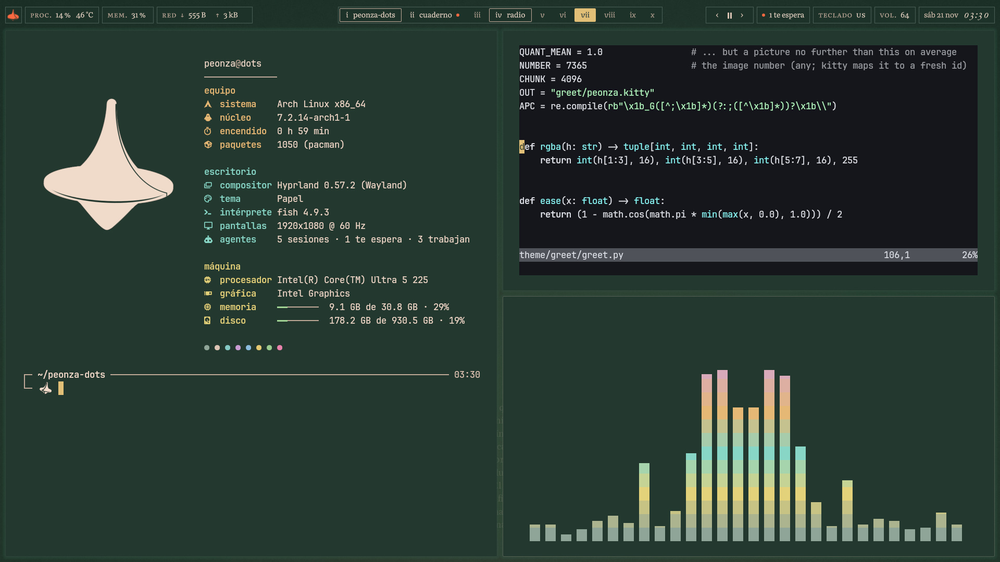</td><td></td></tr>
</table>
</details>

## In motion

https://github.com/user-attachments/assets/42c5e769-f902-4be1-b90a-a8c7440fbc11

<sub>Recorded inside a nested Hyprland with invented tasks, sessions and a procedurally
generated track; `tools/showcase/` rebuilds it from scratch.</sub>

## The top

<table>
<tr>
<td width="50%">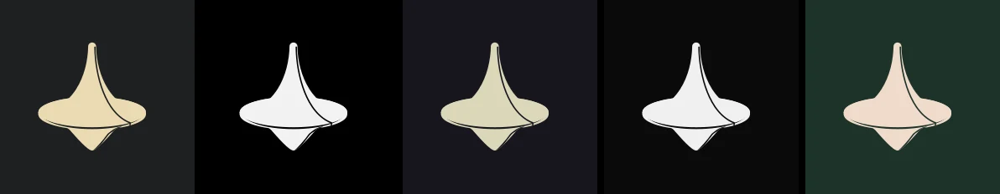</td>
<td width="50%">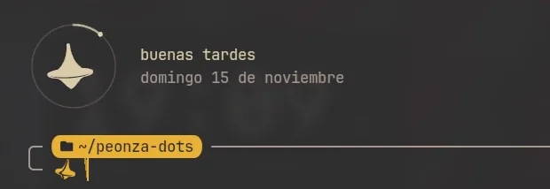</td>
</tr>
<tr>
<td><sub><b>Boot.</b> Plymouth, one frame per refresh at 60 Hz, 72 frames per turn.</sub></td>
<td><sub><b>Every terminal.</b> A four-line greeter in kitty's graphics protocol, precomputed per theme and served with <code>cat</code>, so no Python runs at shell start. <code>set -U ryce_greet off</code> turns it off.</sub></td>
</tr>
</table>

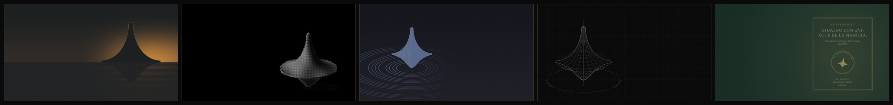

<sub><b>The new tab.</b> Each theme draws its own, grown from the top's measured profile. The prompt
ends with the top too, a glyph in the bundled <i>Ryce Peonza</i> font that turns red when the last
command failed, and so does the cursor.</sub>

## One accent, one meaning

Each theme has one accent colour, and it says one thing: **a session is waiting for you.** It
lights the waiting window's border, its slot in the bar and the top in the corner. If you don't
see the accent, nobody needs you. A linter fails the build if the accent appears anywhere else.

The sessions come from `agentd`, a small Python service (standard library only, under 40 MB).
It joins Hyprland's event socket, `/proc` and Claude Code's session files to tell which
terminal runs which session, whether it works, waits or rests, and its current step. It never
reads your prompts. If it stops, the bar falls back to plain numbers; if Quickshell crashes three
times in a row, Waybar takes over with the same palette.

## The shell

| № | Part | What it does |
|:-:|---|---|
| 13 | **Side panel**<br><kbd>Super</kbd>&nbsp;<kbd>A</kbd> | the sessions and their current step, music with a visualiser, do-not-disturb, night light, volume |
| 14 | **Music**<br><kbd>Super</kbd>&nbsp;<kbd>M</kbd> | a player for Navidrome and other Subsonic servers, with covers and a queue; mpv plays, so media keys and the bar see it |
| 15 | **Tasks**<br><kbd>Super</kbd>&nbsp;<kbd>H</kbd> | Hito's lists: today, overdue, upcoming |
| 16 | **Cheatsheet**<br><kbd>Super</kbd>&nbsp;<kbd>F1</kbd> | every bind, generated from the same table that defines them |
| 17 | **Volume** | an OSD with the top and a level |

<table>
<tr>
<td width="50%" valign="top">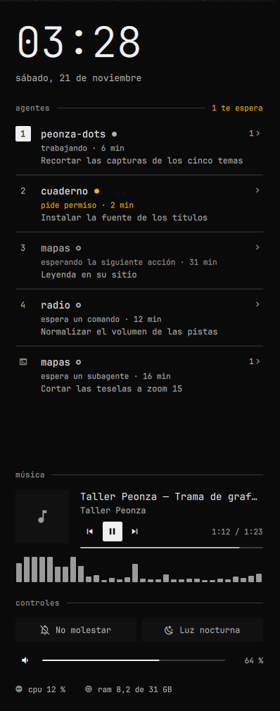</td>
<td width="50%" valign="top">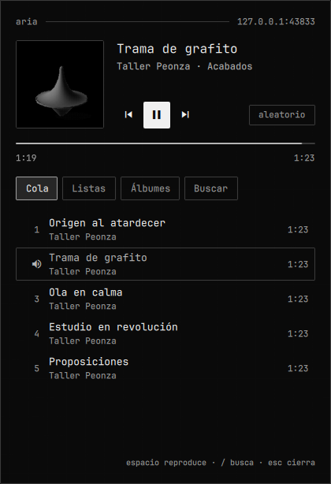<br><br>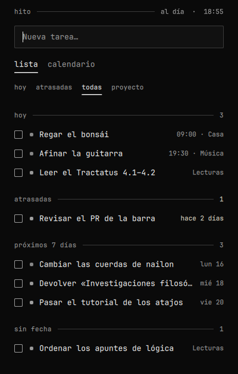</td>
</tr>
<tr>
<td colspan="2">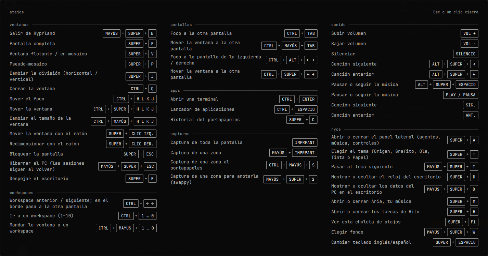</td>
</tr>
</table>

<details>
<summary><b>How it is built</b></summary>
<br>

- **One source per theme.** `contracts/themes/<theme>.json` → `theme/render.py` and the
  generators → `themes/<theme>/`, committed. The programs: Hyprland, the Quickshell bar and
  panels, Waybar, kitty, fish and starship, rofi, mako, btop, cava, Neovim, VS Code, GTK, Qt,
  Feishin, Zotero, Chromium, hyprlock, the login greeter, GRUB, Plymouth and Claude Code. A
  theme can override a template (`theme/templates/@<theme>/`) to change shape, not only colour.
  The generator refuses a theme whose text falls under 4.5:1 contrast or whose accent sits
  within ΔE2000 20 of a grey.
- **Keys from one table.** `keys/keymap.tsv` generates `hypr/binds.lua`, the cheatsheet and
  [`docs/atajos.md`](docs/atajos.md).
- **Hyprland 0.57 speaks Lua.** The config is `hypr/*.lua`, validated with `--verify-config`.
- **A stage instead of a VM.** `tools/stage/nested.sh` runs a nested Hyprland hidden in a special
  workspace of your own session, with its own D-Bus, state and theme. The tests, the screenshots
  and the video come from it.
- **Checks.** `bash check.sh` runs the unit tests, palette and contrast checks, the linter,
  shellcheck and the config verification.
- **The mark's sources are private.** Everything drawn from the top ships pre-built; the checks
  that redraw it skip themselves when the sources are absent.

</details>

## Install

> [!IMPORTANT]
> Arch Linux only, tested on Hyprland 0.57.x and Quickshell 0.3.2. Hyprland's minor releases
> break configs, so check `hyprctl version` first. NVIDIA needs your own driver setup.

```sh
git clone --depth 1 https://github.com/lameiro0x/peonza-dots ~/peonza-dots
cd ~/peonza-dots
./install.sh            # shows the plan, asks once
```

The installer uses only official Arch packages: no AUR helper, and never an `-Syu` behind your
back. It links each config file one by one, so keep the folder where you cloned it, and moves
anything it replaces to `~/.local/state/ryce/backup/`, recording every move in a manifest.
Nothing under `/etc` changes unless you ask for it.

| Flag | Effect |
|---|---|
| `--dry-run` | print the plan, change nothing |
| `--theme NAME` | start in `origen`, `grafito`, `ola`, `tinta` or `papel` |
| `--configs-only` | links only: no packages, no sudo |
| `--packages core\|apps\|dev` | how much to install (`core` by default) |
| `--system` | XDG folders and the themed login page (greetd), only if no other display manager runs |
| `--boot` | themed GRUB and Plymouth: a dry run first, then the real one, with a rollback |
| `--uninstall` | remove the links and put your files back, from the manifest |
| `--restore [STAMP]` | put one backup set back |

The desktop's own labels are in Spanish. Optional parts stay out of the way when they have
nothing to talk to: the task card needs a Hito backend, the music panel asks for a Navidrome
server the first time you open it, and the agent bar only lights up if you use Claude Code.
Machine-specific settings, such as monitors and keyboard layout, go in `hypr/local.lua`, which
is never committed.

## Keys

<kbd>Ctrl</kbd> is the main modifier, and Caps Lock is another <kbd>Ctrl</kbd>.

| Keys | Does |
|---|---|
| <kbd>Ctrl</kbd>&nbsp;<kbd>Enter</kbd> · <kbd>Ctrl</kbd>&nbsp;<kbd>Space</kbd> · <kbd>Ctrl</kbd>&nbsp;<kbd>Q</kbd> | terminal · launcher · close |
| <kbd>Ctrl</kbd>&nbsp;<kbd>1</kbd>…<kbd>0</kbd> · <kbd>Ctrl</kbd>&nbsp;<kbd>←</kbd>&nbsp;<kbd>→</kbd> | workspace · previous, next (1–5 on the first screen, 6–10 on the second) |
| <kbd>Ctrl</kbd>&nbsp;<kbd>H</kbd>&nbsp;<kbd>J</kbd>&nbsp;<kbd>K</kbd>&nbsp;<kbd>L</kbd> | move focus |
| <kbd>Super</kbd>&nbsp;<kbd>T</kbd> · <kbd>Super</kbd>&nbsp;<kbd>Shift</kbd>&nbsp;<kbd>T</kbd> | theme picker · next theme |
| <kbd>Super</kbd>&nbsp;<kbd>A</kbd> | side panel |
| <kbd>Super</kbd>&nbsp;<kbd>M</kbd> · <kbd>Super</kbd>&nbsp;<kbd>H</kbd> | music · tasks |
| <kbd>Super</kbd>&nbsp;<kbd>D</kbd> · <kbd>Super</kbd>&nbsp;<kbd>Shift</kbd>&nbsp;<kbd>D</kbd> | desk clock · desk stats |
| <kbd>Super</kbd>&nbsp;<kbd>Shift</kbd>&nbsp;<kbd>W</kbd> | wallpaper picker |
| <kbd>Super</kbd>&nbsp;<kbd>Esc</kbd> | lock |
| <kbd>Super</kbd>&nbsp;<kbd>F1</kbd> | every other key |

## Credits

Built on [Hyprland](https://hyprland.org), [Quickshell](https://quickshell.org),
[awww](https://github.com/LGFae/awww), [kitty](https://sw.kovidgoyal.net/kitty/),
[cava](https://github.com/karlstav/cava), [btop](https://github.com/aristocratos/btop),
[fish](https://fishshell.com), [starship](https://starship.rs) and
[Waybar](https://github.com/Alexays/Waybar). Inspired by the method, not the configs, of many
r/unixporn posts; Tinta's lock screen follows the layout of the lock in
[1tg82cr](https://www.reddit.com/r/unixporn/comments/1tg82cr/).

Wallpapers not drawn here are public-domain scans: Katsushika Hokusai, *The Great Wave off
Kanagawa*, *Fine Wind, Clear Morning* and *Kajikazawa in Kai Province*; Utagawa Hiroshige, *The
Whirlpools of Awa*; Frederic Edwin Church, *Twilight in the Wilderness*; Jasper Francis Cropsey,
*Autumn – On the Hudson River*. Sources are in
[`assets/wallpapers/README.md`](assets/wallpapers/README.md). Fonts: Martian Mono, Space Grotesk,
Doto, Instrument Serif and Space Mono, under the SIL OFL.

## Licence

The code is [MIT](LICENSE). The peonza mark and everything drawn from it (the generated
wallpapers, the boot, login and new-tab art, the cursor, the *Ryce Peonza* glyphs and the
pictures in this README) are © lameiro0x, all rights reserved, and come along so the desktop
works; see [NOTICE](NOTICE). More of the top at **[art.lameiro0x.com](https://art.lameiro0x.com)**.

```text
┌───────────────────────────────┬───────────────┐
│ TITLE   peonza-dots           │ SHEET  PD-001 │
├───────────────┬───────────────┼───────────────┤
│ PROJECT ryce  │ SCALE 1:1     │ DATE 2026.11  │
├───────────────┴───────────────┴───────────────┤
│ DRAWN  lameiro0x · art.lameiro0x.com          │
└───────────────────────────────────────────────┘
```
